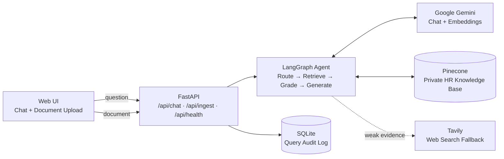
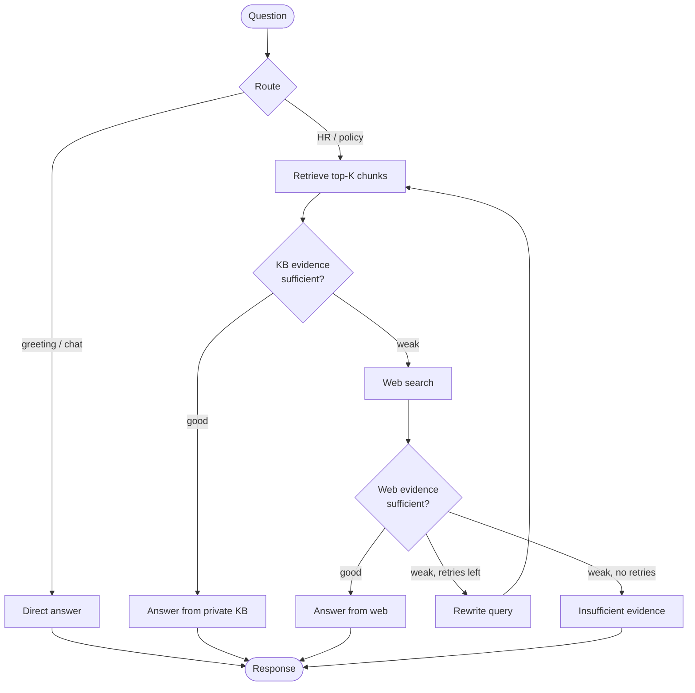

# PolicyPilot

**Agentic RAG assistant for company HR policies and employee support.**

PolicyPilot answers from a private Pinecone knowledge base first, grades the retrieved evidence, and only falls back to external web search when the private knowledge base is not strong enough. Every answer is grounded, cited, and recorded in a local audit log.

---

## Architecture



## Agent workflow



The graph is defined in `app/rag/workflow.py`. Each response includes the answer, the source used (`private_kb`, `web_search`, `direct`, `insufficient_evidence`), citations, and a step-by-step trace.

## Project structure

```
app/
  api/routes.py          FastAPI endpoints
  core/config.py         Settings, environment variables, paths
  core/logger.py         File logging
  rag/state.py           Graph state and structured-output schemas
  rag/vector_store.py    Gemini embeddings + Pinecone index management
  rag/workflow.py        LangGraph agent
  services/audit.py      SQLite query audit log
  services/ingestion.py  PDF / TXT / MD / DOCX loading and chunking
  main.py                App setup, lifespan, UI route
static/                  Frontend CSS and JavaScript
templates/index.html     Chat UI
data/sample_kb/          Sample HR documents
ingest_sample_kb.py      CLI to index data/sample_kb
```

---

## Quick start

Requires **Python 3.12**.

```powershell
python -m venv .venv
.\.venv\Scripts\Activate.ps1
pip install -r requirements.txt
Copy-Item .env.example .env
```

Set your keys in `.env`, then start the server:

```powershell
python run.py
```

Open <http://127.0.0.1:8080>.

## Configuration

| Variable | Purpose |
| --- | --- |
| `GEMINI_API_KEY` | Google Gemini key for chat and embeddings |
| `GOOGLE_API_KEY` | Optional separate key for embeddings; falls back to `GEMINI_API_KEY` |
| `GEMINI_MODEL` | Chat model (default `gemini-3.8-flash`) |
| `EMBEDDING_MODEL` | Gemini embedding model (default `gemini-embedding-001`) |
| `EMBEDDING_DIMENSION` | Optional dimension override; must match the Pinecone index |
| `PINECONE_API_KEY` | Pinecone API key |
| `PINECONE_INDEX_NAME` | Index name (default `policypilot`) |
| `PINECONE_NAMESPACE` | Namespace (default `company-hr-kb`) |
| `PINECONE_CLOUD` / `PINECONE_REGION` | Serverless location (default `aws` / `us-east-1`) |
| `TAVILY_API_KEY` | Optional web search fallback |
| `TOP_K` | Chunks retrieved per query (default `4`) |
| `MAX_WEB_REWRITES` | Query-rewrite retries on weak web evidence (default `1`) |
| `ADMIN_API_KEY` | Required by `POST /api/ingest`; change before deploying |
| `MAX_UPLOAD_MB` | Upload size limit (default `25`) |
| `DATABASE_PATH` | SQLite audit log path (default `data/audit.db`) |

The Pinecone index is created automatically with the dimension implied by `EMBEDDING_MODEL` (or `EMBEDDING_DIMENSION` when set). Use a dedicated index and namespace for PolicyPilot — pointing it at a shared index will return unrelated documents.

## Indexing documents

Use the **Add HR Document** button in the UI, or call the API:

```powershell
curl.exe -X POST http://127.0.0.1:8080/api/ingest `
  -H "X-Admin-Key: <your-admin-key>" `
  -F "file=@data/sample_kb/company_hr_handbook.md"
```

To index every document in `data/sample_kb`:

```powershell
python ingest_sample_kb.py
```

Supported formats: `.pdf`, `.txt`, `.md`, `.docx`.

## API

| Method | Endpoint | Description |
| --- | --- | --- |
| `GET` | `/api/health` | Service health check |
| `POST` | `/api/chat` | JSON body `{"question": "..."}` |
| `POST` | `/api/ingest` | Multipart upload with `X-Admin-Key` header |

`POST /api/chat` returns the answer, `source_used`, `citations`, `trace`, and the final `rewritten_query`.

## Docker

```powershell
docker build -t policypilot .
docker run --rm -p 8080:8080 --env-file .env policypilot
```

## Tech stack

**FastAPI** · **LangGraph** · **LangChain** · **Google Gemini** · **Pinecone** · **Tavily** · **SQLite**
